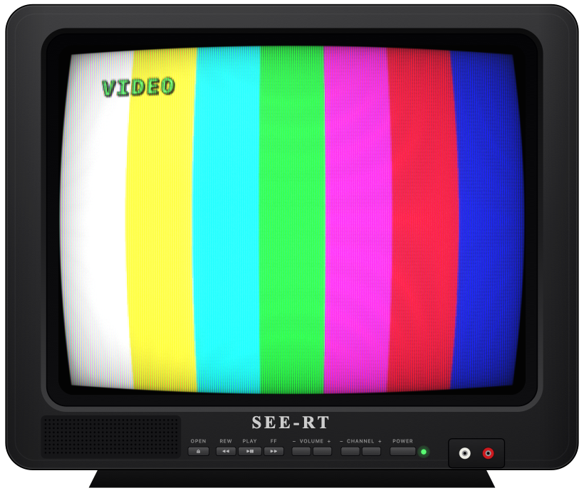
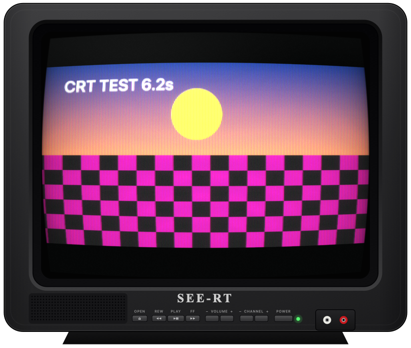
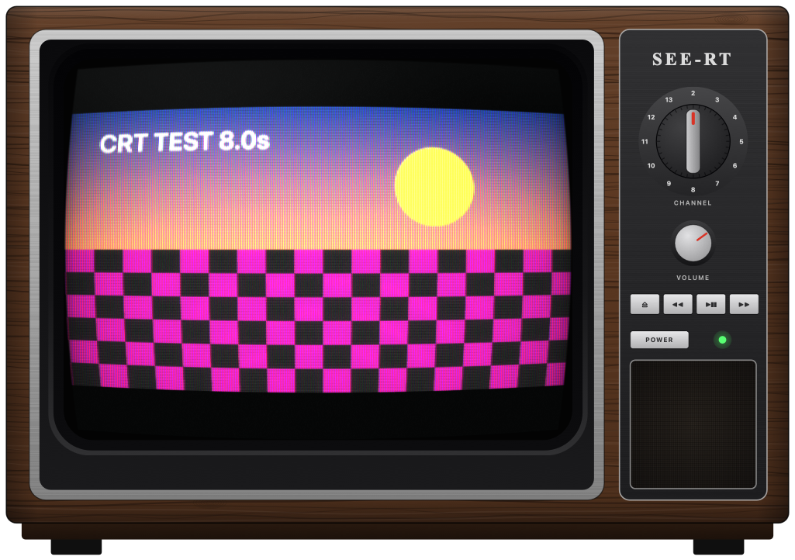
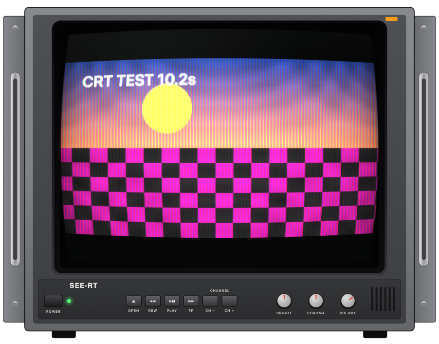
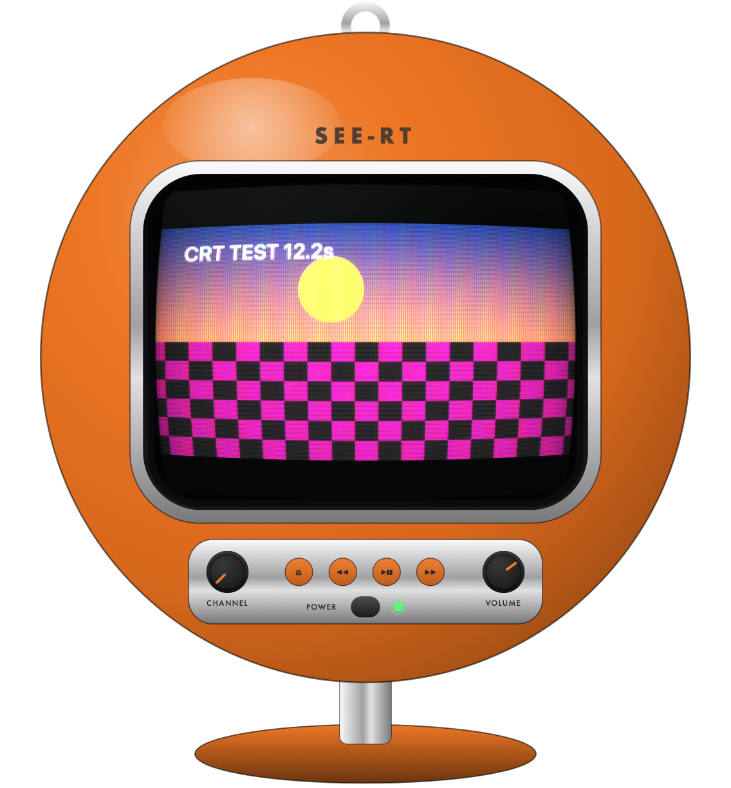
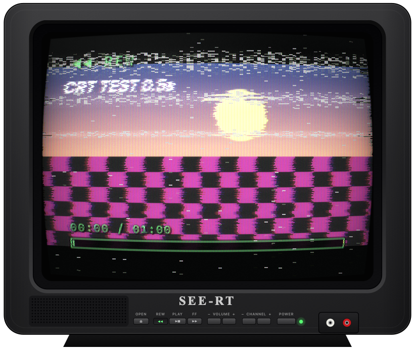

# SEE-RT

**A video player for macOS that makes your videos look like they're playing on an old CRT television.**

SEE-RT plays MKV, MP4 and most other video files inside a window drawn as a classic tube TV. You get scanlines, phosphor glow, curved glass, interlacing, VHS-style rewinding, and four TV cabinets to choose from.



## Features

- **Real CRT look.** Low-resolution raster, scanlines, aperture-grille phosphor stripes, curved glass, glow, flicker, hum bar and grain, all rendered on the GPU with Metal.
- **Picture modes.** *Clean*, *Authentic (480i)* with interlacing, and *Worn Out*, plus separate scan-mode, phosphor-persistence (ghosting) and scanline-density settings.
- **VCR controls.** Rewind and fast-forward with tracking-noise bands, wobble and dropouts, and a pause that shows tape noise. The green on-screen display (OSD) shows channel, volume, time and progress.
- **Channels.** Every video in the same folder as the one you open becomes a channel.
- **Four cabinets, each in several colours.** Click their buttons, dials and knobs to work the TV.
- **Your own brand name** on the front of the set.
- **Brightness and saturation controls**, full screen, resizable window, power-off animation, and snapshots saved to your Desktop.
- **Plays almost anything:** MKV, MP4, MOV, AVI, WebM and more, using VLC's playback engine, which is built into the app.

| Living Room '98 | Wood-Grain Console '82 |
|:---:|:---:|
|  |  |
| **Pro Studio Monitor** | **Space Age '71** |
|  |  |



## Requirements

- A Mac with **Apple Silicon** (M1 or later)
- **macOS 13 Ventura** or later

## Install

1. Download `SEE-RT.zip` from the [Releases](../../releases) page and double-click it to unzip.
2. Drag **SEE-RT** into your **Applications** folder.
3. Open it. SEE-RT isn't signed with an Apple developer certificate, so the first time macOS will say it can't verify the app:
   - Click **Done** (or **OK**).
   - Open **System Settings → Privacy & Security**, scroll down, and click **Open Anyway** next to the SEE-RT message.
   - Confirm with **Open**. You only need to do this once.

   On macOS 13 or 14 you can instead right-click the app, choose **Open**, then click **Open** again.

## Using it

Click **OPEN** on the TV, press **⌘O**, or drag a video file onto the TV. You can also right-click a video in Finder and choose **Open With → SEE-RT**.

| Key | Action |
|---|---|
| Space | Play / pause |
| R / F | Rewind / fast-forward (VHS scan) |
| ← / → | Skip 10 s (hold Shift for 60 s) |
| ↑ / ↓ | Volume |
| [ / ] | Previous / next channel (other videos in the folder) |
| M | Mute |
| P | Power |
| Z | Zoom to fill the 4:3 screen |
| ⌃⌘F, Esc | Enter / exit full screen |
| ⌘1 to ⌘4, ⌘= / ⌘−, ⌘0 | Window size: presets, bigger / smaller, fit to screen |
| ⌥⌘P | Picture adjustments (brightness, saturation) |
| ⌘S | Save a snapshot to the Desktop |

Drag the TV to move it, or drag its edges to resize it.

**Menus:**
- **Picture:** brightness and saturation, Picture Mode, Scan Mode, Phosphor Persistence, scanline density, curved glass and zoom.
- **Cabinet:** skin, colour and brand name.

All settings are remembered between launches.

## Build from source

You need the Xcode Command Line Tools (`xcode-select --install`) and [VLC](https://www.videolan.org/vlc/) installed in `/Applications`. The build copies VLC's playback engine into the app, so the finished app doesn't need VLC.

```bash
git clone <this repository>
cd <repository folder>
./build.sh
open "build/SEE-RT.app"
```

### How it's put together

| File | What it does |
|---|---|
| `Sources/VLCPlayer.swift` | Wraps libvlc; decoded frames arrive through video callbacks into a triple buffer |
| `Sources/CRTRenderer.swift` | Metal renderer: CRT pass, then a phosphor-persistence pass |
| `Resources/CRT.metal` | The CRT and VHS shader, compiled when the app starts, so you can edit it inside the app bundle and relaunch |
| `Sources/Skins.swift` | The four cabinet designs and their colours |
| `Sources/TVBodyView.swift` | Cabinet view, mouse and keyboard handling |
| `Sources/TVController.swift` | Playlist, power, volume, scanning, picture settings and OSD state |
| `Sources/OSD.swift` | The green on-screen display |
| `Tools/MakeIcon.swift` | Draws the app icon |

## Licence

SEE-RT is free software, released under the **GNU General Public License, version 2 or (at your option) any later version**. See [LICENSE](LICENSE).

### VLC

SEE-RT includes the playback engine from [VLC media player](https://www.videolan.org/vlc/) (libvlc, libvlccore and VLC's plugins) by VideoLAN and the VLC authors:
- **Licences:** libvlc is licensed under the LGPL 2.1 or later, and some plugins under the GPL.
- **Source code:** the engine in the release build comes from **VLC 3.0.24**, whose source code is available from VideoLAN at <https://download.videolan.org/pub/videolan/vlc/3.0.24/>.
- **Trademark:** VLC is a trademark of VideoLAN. SEE-RT is not affiliated with or endorsed by VideoLAN.
